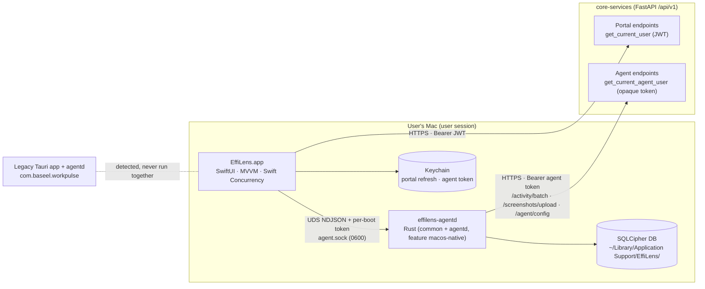
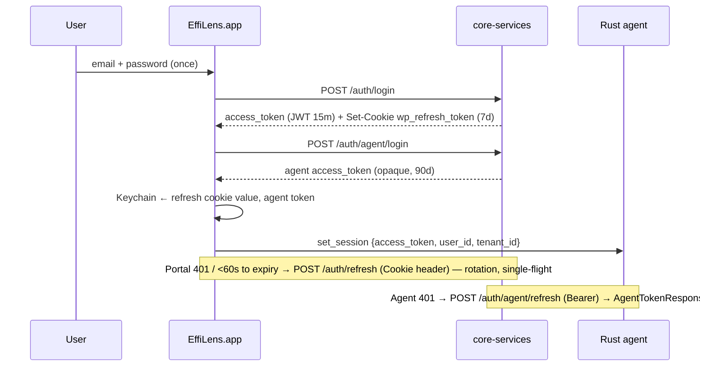

# EffiLens Native macOS — Architecture

Status: Phase 2 (proposed defaults applied) · Milestones 1–2 code present · **not yet built on macOS**

## 1. High-level



Responsibilities:

| Layer | Owns | Never does |
|---|---|---|
| SwiftUI app | UI, sign-in, portal data (leave, dashboard, reports, notifications), permissions UX, menu bar, lifecycle of the agent | Capture activity, compute balances/approvals, store events |
| Rust agent | Capture (app/window/idle/input counts/browser domain/meetings/screenshots), timer state machine, offline queue, batch sync | Render UI, talk to portal endpoints |
| core-services | All business logic, auth, persistence, approval workflows | — (unchanged; no backend change needed for Milestones 1–6) |

## 2. SwiftUI application

```mermaid
flowchart TB
  App[EffiLensApp] --> Root[RootView]
  Root -->|phase| SignIn & Consent & Shell[MainShellView]
  Shell --> Sidebar & Detail
  Detail --> Dash[DashboardView + VM] & Leave[LeaveOverviewView + VM] & More[… feature screens]
  App --> MenuBar[MenuBarExtra] & Settings[Settings scene]
  subgraph Kit[EffiLensKit (Swift package, UI-free, unit-tested)]
    API[APIClient] --- Sess[SessionManager actor] --- KCS[KeychainStore]
    Svc[Services: Leave, Work, Insights, Profile, Consent, Notifications, AgentAPI]
    IPC[AgentClient actor (Network.framework UDS)]
  end
  Dash & Leave --> Svc
  App --> Model[AppModel @MainActor @Observable]
  Model --> Sess & IPC
```

- **Package split**: `EffiLensKit` (networking, models, session, IPC) has no SwiftUI dependency → `swift test` headless. App target = `Sources/App`, `Sources/DesignSystem`, `Sources/Features`.
- **MVVM**: one `@Observable @MainActor` view model per screen; services are `Sendable` structs; long-lived state in actors.
- **DI**: `AppEnvironment` built once in `EffiLensApp.init`, passed explicitly. No singletons.
- **State**: every async datum is `Loadable<T>` (idle/loading/loaded/failed) → uniform loading, empty, error states; no placeholder data in production.

## 3. Python backend integration

All endpoints and schemas verified in `core-services/app/api/v1/*.py` and `app/schemas/*.py` (see API_INTEGRATION.md). Codable models mirror Pydantic field names via snake_case key strategy; `Decimal` arrives as JSON string (`FlexibleDecimal`); `date` → `CalendarDate`; naive datetimes are UTC.

## 4. Authentication & token lifecycle



Verified facts: portal routes use `get_current_user` (JWT only); only `/consent/*` and `/projects*` accept either token (`get_current_user_or_agent`). Therefore the app holds both credentials. No backend change required. Desktop SSO needs a new code-exchange endpoint (gap B2 — proposal only).

Caveat (existing backend behaviour): `/auth/agent/login` revokes the user's previous device named `workpulse-agent` — on any machine. Signing in on the Mac invalidates that user's other agent logins (same as Tauri/Windows today).

## 5. IPC

NDJSON over Unix domain socket, protocol inherited from `common::ipc_transport` (`{cmd,payload}` → `{ok,data,error}`) plus an `auth` field. Socket `~/Library/Application Support/EffiLens/agent.sock` (0600); per-boot 256-bit token in `ipc.token` (0600) checked in constant time; daemon also verifies peer UID (`getpeereid`). Swift client verifies token file owner/permissions, one connection per request, 3 s timeout. Details: RUST_AGENT_INTEGRATION.md.

## 6. Local persistence

| Data | Where | Protection |
|---|---|---|
| Portal refresh token, agent token | Keychain (generic password, service = bundle id, ThisDeviceOnly) | Keychain ACL |
| Portal access token | Memory only | — |
| Events, task logs, screenshots queue | Agent SQLCipher DB in `EffiLens/` | SQLCipher, key in Keychain (native daemon; Tauri used a 0600 file) |
| UI prefs (selected route, appearance) | `@SceneStorage` / `UserDefaults` | non-sensitive |

## 7. Offline-first

The agent queues events/time logs/screenshots locally and syncs every `batch_sync_interval_min` with the existing backoff (`min(2^n·60,1800)` s). The UI keeps working offline for tracking; portal screens show `AppError.offline` states with retry. Toolbar sync pill reflects `get_sync_status` (`pending_events`).

## 8. Background lifecycle

- App: regular app + `MenuBarExtra`; closing the main window keeps the menu bar item. Quit while tracking → confirmation (Milestone 7).
- Agent: registered with `SMAppService.agent(plistName:)` from `Contents/Library/LaunchAgents/com.baseel.effilens.mac.agent.plist`; `KeepAlive` on crash; runs in the user session. "Open at Login" uses `SMAppService.mainApp`.

## 9. Permissions

Accessibility (AX window titles/frames), Screen Recording (ScreenCaptureKit window capture), Automation/Apple Events (browser URL → eTLD+1), Notifications. Requested only in onboarding with explanations; state polled via agent `get_permissions` + `AXIsProcessTrusted`/`CGPreflightScreenCaptureAccess`. Missing permission ⇒ that capture is disabled (never a silent full-screen fallback).

## 10. Errors, logging, diagnostics

`AppError` maps HTTP/IPC failures to user-safe messages; `os.Logger` subsystem `com.baseel.effilens.mac` with privacy redaction; About & Diagnostics (M7) exports logs (redacted) + agent health.

## 11. Updates

Separate from Tauri's `/agent/update/{target}/...` feed. Proposed: Sparkle 2 (EdDSA-signed appcast) or a backend appcast endpoint (gap B7) — decision pending. Until then, "Check for Updates" is disabled.

## 12. Installation & launch

Signed + notarised DMG (drag-to-Applications) built by `Scripts/release.sh`; optional PKG later for MDM. First launch → onboarding (sign-in → device check → privacy consent → permissions → agent start → initial sync).
